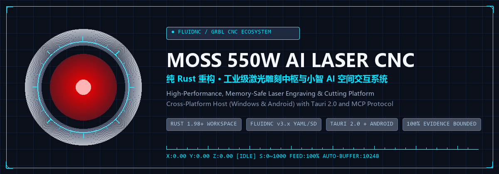

<p align="center">
  
</p>

<h1 align="center">MOSS 550W AI Laser CNC</h1>

<p align="center">Industrial-grade, memory-safe laser engraving and cutting ecosystem in pure Rust with Xiaozhi AI integration.</p>

<p align="center">
  <a href="./README.md">English</a> | <a href="./README.zh-CN.md">简体中文</a>
</p>

<p align="center">
  <a href="./LICENSE"></a>
  
  
  
  
</p>

## Highlights

| Capability | Why it matters |
|---|---|
| Pure Rust Core | Completely eliminates Python runtime dependencies, delivering microsecond-level motion planning and zero-garbage-collection execution. |
| FluidNC & GRBL Integration | Automatic YAML config extraction ($CD), dynamic Rx buffer streaming (1024B), and offline SD execution with real-time status telemetry. |
| Strict Safety Gates | Physical SHA-256 G-code recalculation before firing, non-blocking 0x18 software-reset channel, and backend material safety gates that block PVC and require clarification for unknown plastics. |
| Cross-Platform Desktop & Mobile | Tauri 2.0 desktop shell on Windows and standard single-command reproducible Android APK packaging. |
| Xiaozhi AI Voice Control | Native Model Context Protocol (MCP JSON-RPC 2.0) server bridging AI assistants to physical tool execution. |

## Architecture

For installation, upgrades and uninstall behavior, see the
[installation guide](docs/user/quick-start.md#安装与卸载).

```text
Web / Tauri Desktop and Android ── HTTP + polling ──► laser-api
Tauri shell ── starts ──► laser-host ── assembles ──► laser-api / laser-mcp
                              └── initializes ──► laser-runtime (SQLite)
Xiaozhi console ◄── WebSocket ──► laser-mcp ── catalog ──► laser-tools
                                   └── HostBackend (in laser-host)
                                           └──► laser-api (persistence/jobs)
laser-api ──► laser-core (toolpaths) / laser-runtime (records)
laser-api ── confirmation, file SHA, device preflight ──► laser-device
laser-tools ── standalone safety actions / probes ──────────► laser-device
laser-device ── serial / Telnet ──► FluidNC / GRBL controller
```

`laser-core` calculates toolpaths but never connects to the machine. MCP tools requiring persistence or job execution return through the host's `HostBackend` to `laser-api`. `0x18` is a software reset request, not a substitute for the machine's physical emergency-stop switch.

## Usage Example

The following demonstrates generating an outline toolpath from vector text and confirming the send gate:

```bash
# 1. Preview vector task via local API (generates G-code without firing laser)
curl -X POST http://127.0.0.1:9666/api/workflow \
  -H "Content-Type: application/json" \
  -d '{"action":"preview","source_type":"text","text":"MOSS","engraving_mode":"outline","material":"Basswood","thickness_mm":3}'

# Expected response contains:
# {"status":"prepared","gcode_sha256":"<computed-hash>","workflow_id":"wf-..."}

# 2. Execute send gate (fails if file was altered on disk or unconfirmed)
curl -X POST http://127.0.0.1:9666/api/workflow \
  -H "Content-Type: application/json" \
  -d '{"action":"confirm_send","workflow_id":"wf-...","confirmed":true}'

# Hardware executes only after strict SHA-256 verification and idle probe handshake.
```

## Quick Install

Ensure Rust 1.98+, Node.js 20+, and Android SDK/NDK (optional for mobile) are installed.

```powershell
# Clone the repository
git clone https://github.com/farion1231/moss-rust.git
cd moss-rust

# Install frontend dependencies
cd frontend
npm install
cd ..
```

## Quick Start

### 1. Run Desktop Application (GUI)

```powershell
cd apps/desktop/src-tauri
cargo tauri dev
```

### 2. Build Android Debug APK

```powershell
cd apps/desktop/src-tauri
cargo tauri android build --debug --target aarch64 --apk
# Output lands at gen/android/app/build/outputs/apk/universal/debug/app-universal-debug.apk
```

### 3. Run Standalone Headless Host

```powershell
cd apps/moss-host
cargo run -- serve
```

## Documentation

Full project documentation is organized in [`docs/`](./docs/README.md):

- [Quick Start Guide](./docs/user/quick-start.md): Hardware setup, runtime directory, local network pairing, and engraving safety workflow.
- [Architecture Overview](./docs/developer/architecture.md): Rust host models, crate dependency hierarchy, HTTP/MCP bridge, and E-STOP paths.
- [Development Standards](./docs/developer/standards.md): Code conventions, tool catalog registration, and PR checklist.
- [Safety Gates & Preflight](./docs/developer/safety.md): SHA-256 recalculation, FluidNC adaptive spindle speed, and E-STOP handling.
- [Web API Contracts](./docs/developer/api-contracts.md): Complete HTTP routes, SSE events, and Bearer authentication specification.
- [Database Schema](./docs/developer/db-schema.md): SQLite v2 table definitions, schema migrations, and material preset formats.
- [Laser Hardware & FluidNC](./docs/laser/README.md): Machine baseline, firmware configuration, and network protocol reference.
- [Xiaozhi Prompt Archive](./docs/integration/xiaozhi-prompts/README.md): Console prompt archive and knowledge base limits.

## Verification

Run all automated verification suites before committing changes:

```powershell
# Rust workspace verification (including architecture type boundary guard)
cargo test --workspace

# Frontend unit tests
cd frontend && npm test && cd ..

# Full interaction E2E closed-loop tests (launches loopback simulator)
cd frontend && npm run test:e2e && cd ..
```

## License

This project is licensed under the [MIT License](./LICENSE).
