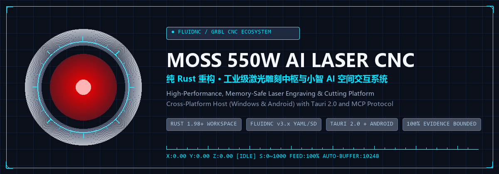

<p align="center">
  
</p>

<h1 align="center">MOSS</h1>

<p align="center">面向 FluidNC / GRBL 与 ESP32 下位机的纯 Rust 激光数控雕刻上位机与内置小智 AI 语音中枢，支持 Windows、macOS 与 Android。</p>

<p align="center">
  <a href="./README.md">English</a> | <a href="./README.zh-CN.md">简体中文</a>
</p>

<p align="center">
  
  
  
  
  <a href="./LICENSE"></a>
  <a href="./docs/README.md"></a>
</p>

MOSS 在单一 Rust 工作区内集成了矢量/位图刀路生成、Three.js 3D 机床数字孪生、Excalidraw 创意画板、FluidNC / GRBL 串口与网络脱机控制，以及内置的小智 AI 语音服务与 MCP 工具桥。刀路计算层与物理硬件严格隔离，任何运动、出光、智能家居控制或本机 CLI Agent 执行都必须经过后端预检与显式审批门禁。

## 核心亮点

| 能力 | 实际价值 |
| --- | --- |
| 纯 Rust 刀路内核 | `laser-core` 独立完成轮廓、填充与位图 G-code 解算及工时估算，无 Python 运行时依赖，且不触碰串口或网络。 |
| FluidNC 与 GRBL 协同 | 握手自动读取控制器 YAML 配置（`$CD`），支持 `1024B` 动态接收缓冲流控，以及带哈希校验的 SD 卡脱机上传加工。 |
| 多重物理安全门禁 | 出光前重新读取磁盘 G-code 校验 SHA-256，`0x18` 软复位走独立实时通道不排队，后端自动拦截 PVC 并对未知塑料强制要求确认。 |
| 内置小智语音中枢 | 原生内置小智 WebSocket / OTA 语音管线（`moss-voice-server`），支持云端模型与离线本地模型（`moss-voice-local` 判停、识别、合成、声纹提示）及 MCP JSON-RPC 2.0 调度。 |
| 3D 数字孪生与创意画板 | 前端整合主控工作台（`/`）、Excalidraw 手绘矢量画板（`/draw`）与 Three.js 三维机床行程及刀路预览（`/twin`）。 |
| 默认关闭的受控扩展 | 家居控制、本机 `Claude Code` / `Codex` 执行、声纹提示与固件下发默认全部关闭；在语音私密窗口显式开启后，敏感动作仍须逐次在桌面审批卡确认。 |

## 系统架构

```text
+-----------------------------------------------------------------------------------+
| React + Vite Frontend (Workbench / | Drawpad /draw | 3D Twin /twin | Voice /voice)|
+------------------------------------+-------------------------+--------------------+
                                     | HTTP / SSE              | Tauri IPC (private ACL)
                                     v                         v
+-----------------------------------------------------------------------------------+
| Tauri 2 Shell (apps/desktop)  OR  Headless CLI Host (apps/moss-host)              |
|   +-- laser-host (startup orchestration, approvals, guarded local CLI runner)     |
+----------------+-----------------------------+--------------------------+---------+
                 |                             |                          |
                 v                             v                          v
      +--------------------+        +--------------------+     +--------------------+
      | laser-api          |        | laser-mcp          |     | moss-voice-server  |
      | REST + SSE routes  |<-------+ MCP JSON-RPC 2.0   |<----+ Built-in Xiaozhi   |
      +----+----------+----+        +---------+----------+     | WS / OTA / Context |
           |          |                       |                +---------+----------+
           v          v                       v                          | stdio IPC
+---------------+  +------------------+  +--------------+                v
| laser-core    |  | laser-runtime    |  | laser-tools  |     +---------------------+
| G-code / font |  | SQLite WAL store |  | ToolCatalog  |     | moss-voice-local    |
| (no hardware) |  | + OS secret store|  +------+-------+     | Offline VAD/ASR/TTS |
+---------------+  +--------+---------+         |             | (standalone GPL-3)  |
                            |                   |             +---------------------+
                            v                   v
                 +--------------------------------------+
                 | laser-device (preflight + 0x18 lane) |
                 +------------------+-------------------+
                                    | Serial / Telnet / HTTP SD upload
                                    v
                 +--------------------------------------+
                 | FluidNC / GRBL / ESP32 Controller    |
                 +--------------------------------------+
```

`laser-core` 只负责生成刀路与预览，不连接任何硬件；需要持久化或触发加工的 MCP 工具统一经 `laser-host` 的 `HostBackend` 回到 `laser-api`，确保网页端与语音端共用同一套 SHA-256 校验、材料门禁与审批记录。注意：`0x18` 为软件实时复位指令，不能替代机床上的物理急停开关。

## 使用示例

下面演示通过本地 HTTP 接口生成矢量文字轮廓预览（不出光），再经确认门禁下发：

```bash
# 1. 生成矢量文字预览（写入 G-code 并计算 SHA-256，绝不向硬件发送数据）
curl -X POST http://127.0.0.1:9666/api/workflow \
  -H "Content-Type: application/json" \
  -d '{"action":"preview","source_type":"text","text":"MOSS","engraving_mode":"outline","material":"椴木","thickness_mm":3}'

# 预期响应关键字段：
# {"status":"prepared","gcode_sha256":"<磁盘文件SHA-256>","workflow_id":"wf-..."}

# 2. 通过确认发送门禁（若未确认或磁盘 G-code 被改动则直接拒绝）
curl -X POST http://127.0.0.1:9666/api/workflow \
  -H "Content-Type: application/json" \
  -d '{"action":"confirm_send","workflow_id":"wf-...","confirmed":true}'
```

只有在重新读取磁盘文件核对 `gcode_sha256` 一致且控制器处于 `Idle` 状态后，`JobWorker` 才会向控制器传输 G-code。

## 快速安装

环境要求：

- **Rust** `1.98+`（`rustup` 稳定版工具链）
- **Node.js** `20+` 与 `npm`
- **平台依赖**：Windows 需 WebView2，macOS（`11.0+`）需 Xcode Command Line Tools，构建 Android APK 时需配置 Android SDK / NDK

```bash
# 克隆仓库
git clone https://github.com/yjdaaa/moss.git
cd moss

# 安装前端依赖
cd frontend
npm install
cd ..
```

## 快速开始

### 1. 启动桌面端开发环境

```bash
cd apps/desktop/src-tauri
cargo tauri dev
```

### 2. 启动无界面独立宿主

```bash
cargo run -p moss-host -- serve
```

### 3. 构建各端发行安装包

```powershell
# Windows：构建 NSIS 安装包并打入 moss-voice-local 离线语音辅助程序
powershell -ExecutionPolicy Bypass -File scripts/build-windows-installer.ps1
```

```bash
# macOS：构建 .app 与 .dmg 安装包（默认打入 moss-voice-local 离线语音辅助程序）
bash scripts/build-macos-installer.sh

# Android：构建 aarch64 发行版 APK
cd apps/desktop/src-tauri
cargo tauri android build --target aarch64 --apk
```

## 自动化验证

在仓库根目录执行以下命令完成回归检查：

```bash
# Rust 主工作区全量测试（含激光链路、语音服务、SQLite 迁移与安全门禁）
cargo test --workspace

# 独立本地语音模型辅助工作区测试
cargo test --manifest-path apps/moss-voice-local/Cargo.toml

# 前端单元测试与生产构建检查
cd frontend && npm test && npm run build && cd ..

# 端到端闭环测试（自动启动回环 GRBL 模拟器验证完整前后端交互）
cd frontend && npm run test:e2e && cd ..
```

## 文档索引

完整用户手册与开发文档归档于 [`docs/README.md`](./docs/README.md)：

| 主题 | 内容说明 | 链接 |
| --- | --- | --- |
| 用户快速开始 | 桌面端与无界面宿主启动、运行目录、手机配对及首次雕刻安全流程 | [docs/user/quick-start.md](./docs/user/quick-start.md) |
| 实机验收手册 | 从单电脑到 ESP32 + FluidNC 实机的六阶段联调顺序与判据 | [docs/integration/moss-hardware-acceptance-plan.md](./docs/integration/moss-hardware-acceptance-plan.md) |
| 系统架构总览 | 进程入口、crate 分层、HTTP/SSE/MCP 桥接与退出/复位路径 | [docs/developer/architecture.md](./docs/developer/architecture.md) |
| 安全门禁规范 | 磁盘 SHA-256 复核、材料拦截、功率换算与 `0x18` 实时复位链路 | [docs/developer/safety.md](./docs/developer/safety.md) |
| 安装包与打包规范 | Windows NSIS、macOS `.app`/`.dmg`、Android APK 与语音辅助程序打包约定 | [docs/developer/packaging-install.md](./docs/developer/packaging-install.md) |
| 内置语音技术书 | 小智协议服务端、本地/云端模型、长期记忆、声纹与私密窗口权限边界 | [docs/integration/moss-native-voice-spec.md](./docs/integration/moss-native-voice-spec.md) |
| Web API 契约 | `/api/*` 与 `/v1/*` 路由定义、SSE 事件、错误码与局域网鉴权 | [docs/developer/api-contracts.md](./docs/developer/api-contracts.md) |
| 数据库结构 | `<RuntimeRoot>/moss.sqlite` 表结构、版本迁移、审批审计与材料库格式 | [docs/developer/db-schema.md](./docs/developer/db-schema.md) |
| 激光硬件与固件 | FluidNC 固件配置、SD 脱机加工流程与 ESP32 网络控制命令参考 | [docs/laser/README.md](./docs/laser/README.md) |
| 开发规范 | 目录职责、代码约定、`ToolCatalog` 工具登记与测试要求 | [docs/developer/standards.md](./docs/developer/standards.md) |

## 开源协议

MOSS 主工作区采用 [MIT 许可证](./LICENSE) 发布。

可选的本地语音模型辅助程序 [`apps/moss-voice-local`](./apps/moss-voice-local/README.md) 为独立 Cargo 工作区，采用 [GPL-3.0-or-later](./apps/moss-voice-local/COPYING) 许可证发布；MOSS 仅通过标准输入输出帧协议（`crates/moss-voice-local-proto`，MIT）与其交换数据，不链接其代码。
